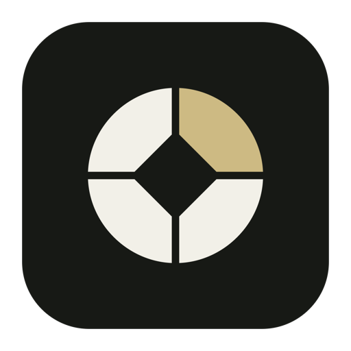
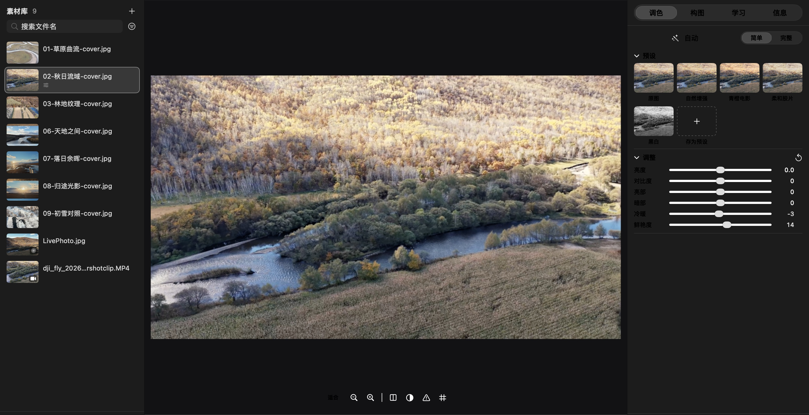

<div align="center">



# 光集

**在 Mac 上把照片调好看，不用先学摄影。**

一键自动 · 六个滑块 · 预设一眼挑 · 调完存进「照片」<br>
照片、视频、Live Photo 都能调。给 DJI 和 iPhone 拍摄者的 Mac 调色工具。

</div>

<p align="center"></p>

## 为什么做光集

我用 DJI 拍素材，想调一下颜色和色调，才发现 DJI Mimo 只有手机版（iOS 和 Android）。想在大屏幕上调，只能回到手机上。

Lightroom、Photoshop 当然什么都能做，但打开的第一眼，就是几十个看不懂的滑块。

光集想做中间那一块：**在 Mac 上，简单得像手机 App；想学的时候，也有人在旁边讲。** 默认只给你最常用的几样，其余的专业工具都在，只是先收起来。

## 它能做什么

**简单开始**
- **自动（A）**：看这张照片本身的明暗和颜色，替你调好曝光、影调、白平衡和色彩。很克制：白底、雪景保持明亮，夜景保持夜景，日落保留暖色。不满意按 ⌘Z 撤销。
- **六个滑块**：亮度、对比度、亮部、暗部、冷暖、鲜艳度，每个都有一句人话解释。
- **预设缩略图**：每个预设直接用你这张照片预览，点一下套用。可以存自己的预设。
- **拖动裁剪**：在「构图」里直接在照片上拖裁剪框，也有拉直、旋转、镜像，地平线歪了会提醒。

**调完回到 iPhone**
- 导出默认**直接存入「照片」**，开启 iCloud 照片后同步到 iPhone。也可以存成文件，或用系统共享发给朋友。
- 视频裁到 3 秒以内可以做成真正的 **Live Photo**；还能把多段拼成一张「拼图 Live」。
- 格式 JPEG / HEIC / PNG，可缩小到社交平台尺寸；默认保留拍摄时间和相机信息，移除位置信息。导出在后台进行，不挡着你继续调。

**为 DJI 素材准备**
- 能打开 DJI 无人机和相机的 MP4 / MOV（含 10 位 HEVC）。「信息」页列出编码、位深、码率、帧率、色彩空间和拍摄设备。
- 导入 DJI 官方的 `.cube` 风格 LUT（已用 Pocket 3 的 Spring / Winter Pro 实测）。
- 视频可以裁切、变速（0.5–4 倍）。

**边调边学**
- 光集会读这张照片，指出真正的问题（哪里过曝、哪里偏色、地平线歪了多少度），并给出可以一键试用的调整。悬停在滑块名上，画面会只高亮它影响的区域。
- 水平分「入门 / 进阶 / 专业」，讲解的深浅随之变化；学习记录只保存在你的 Mac 上。
- 可选的「问问这张照片」：用自然语言提问，由 Claude 结合这张照片回答。需要你自己的 Anthropic API 密钥，**默认关闭**（见下方隐私）。

**想深入时**
- 点「完整」，展开示波器（直方图、波形、分量、矢量）、色轮、曲线、HSL 色彩混合、风格 LUT，按 DaVinci 式的固定顺序处理，每一步都能单独开关对比。
- 对比原片、左右分屏、溢出显示、缩放到 100%、命名版本、拷贝粘贴和批量同步调色。

**整理素材**
- 导入文件夹或直接拖进窗口，缩略图网格显示已调色的样子。评级 0–5、选用 / 排除、按类型 / 评级筛选、搜索。同名的 HEIC/JPG 加 MOV 自动合成 Live Photo。
- 原片在 Finder 里被移动或重命名，光集会提示「找不到原文件」，指给它新位置即可，评级和调整都保留。

## 安装

**系统要求**：Apple 芯片（M 系列）的 Mac，macOS 15 或更高。界面目前只有中文。

1. 到 [Releases](https://github.com/YaoYao021123/pic_review_edit/releases/latest) 下载最新的 `Guangji-…-arm64.zip`，解压，把「光集」拖进「应用程序」。
2. 第一次打开会被系统拦下（提示无法验证开发者），因为目前的版本还没有经过 Apple 公证。放行方法：先双击打开一次，看到提示后点「完成」→ 打开「系统设置 › 隐私与安全性」→ 滚动到最下面 → 在「光集」旁点「仍要打开」。只需要一次。

想自己构建（需要 Xcode 命令行工具，`xcode-select --install`）：

```sh
git clone https://github.com/YaoYao021123/pic_review_edit.git
cd pic_review_edit
bash scripts/run-workbench.sh
```

## 三步上手

1. **导入**：把照片或视频文件夹拖进窗口。
2. **调色**：按 `A` 自动，挑一个预设，用六个滑块微调。想看原图，按 `\`。
3. **存起来**：⌘E 导出，选「保存到 照片」。之后随时回来，调整都还在。

## 快捷键

按 `?` 或 ⌘/ 随时查看完整列表。常用的：

| 按键 | 作用 | 按键 | 作用 |
|---|---|---|---|
| `A` | 自动调整 | `\` 或 `M` | 对比原片 |
| `G` / `E` | 浏览 / 编辑 | `Y` | 左右分屏 |
| `0`–`5` | 评级 | `J` | 显示高光 / 暗部溢出 |
| `P` / `X` / `U` | 选用 / 排除 / 取消 | `Z` | 适合窗口 ↔ 100% |
| ⌘Z / ⇧⌘Z | 撤销 / 重做 | ⇧⌘C / ⇧⌘V | 拷贝 / 粘贴调色 |
| ⌘E | 导出当前 | `Tab` | 隐藏 / 显示两侧面板 |

视频：空格播放，`I` / `O` 入点出点，`C` 设为封面。单键快捷键在输入文字时不会触发。

## 隐私

- 原片**从不被修改**。所有调整保存为一份很小的配方文件，导出时才生成新的副本。
- 没有账号，没有统计，**不上传任何照片**。素材库、配方、学习记录都在 `~/Library/Application Support/Guangji`。
- 唯一会联网的是可选的「问问这张照片」：默认关闭；你填入自己的密钥（保存在钥匙串）后，只有点「提问」时才发送，内容是一张最长边 1024 px、不含拍摄和位置信息的缩略图（可在设置里关掉），加上画面统计与当前参数。按你的账户计费；中国大陆网络可能无法直接访问。

## 现在的限制

光集还是早期版本，诚实地说：

- 仅支持 Apple 芯片 Mac 与 macOS 15+，界面只有中文。
- 还没有 Apple 公证，首次打开需要手动放行（见上方安装）。
- 调色后的 HDR 照片会以普通亮度（SDR）导出，原片的 HDR 增益图不保留。
- 视频的裁剪仍用滑块；不支持多轨道剪辑、转场、字幕。
- 常见相机 RAW 文件可以导入，但只是按普通图片处理，并非 RAW 冲洗；这部分目前测试有限。
- D-Log 等 Log 素材需要自己导入对应的转换 LUT，自动识别还在计划中。
- 导入的文件夹不会自动监视新文件。

## 反馈

遇到问题或想要某个功能，欢迎到 [Issues](https://github.com/YaoYao021123/pic_review_edit/issues) 告诉我们，附上一张截图会很有帮助。

## 开发

构建、测试、发布与代码结构见 [docs/DEVELOPMENT.md](docs/DEVELOPMENT.md)。

---

<sub>光集是独立开发的软件，与 DJI、Apple、Adobe 没有关联，也未获得它们的认可。DJI、Mimo、iPhone、Live Photo、Lightroom、Photoshop 等名称属于各自的所有者。</sub>
